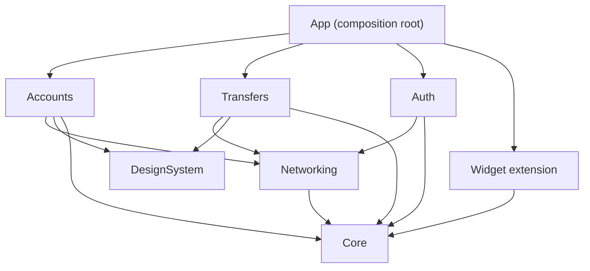

# Maple Wallet

[](https://github.com/jamierowe15/maple-wallet/actions/workflows/ci.yml)

**A modular SwiftUI banking demo: Swift 6 strict concurrency, OAuth PKCE sign-in, offline cache and full VoiceOver support.**
Fictional brand, fake data, no real money.

<!-- auto:demo -->
_Generated automatically by `bash maple-wallet-lab.sh evidence` (runs on GitHub's Macs)._
<!-- /auto:demo -->

## Architecture

- **MVVM**: `@Observable @MainActor` view models with explicit state enums.
- **Protocols at every boundary** (`AccountsService`, `HTTPTransport`, `TokenStore`...), wired in `App/CompositionRoot.swift`.
- **Concurrency**: `async let`, task groups, cancellation via `.task {}`, a `TokenProvider` actor that turns five 401s into one refresh.
- **Security**: Authorization Code + PKCE via `ASWebAuthenticationSession`, tokens only in the Keychain, certificate pinning, file protection, Face ID lock.
- **Accessibility**: VoiceOver labels and custom actions, Dynamic Type to AX5, Reduce Motion, high-contrast colours, iPad split view, automated audit.
- **Apple platform**: Home Screen widget, push notification deep links, Apple Pay top-up.

## Run it
```bash
git clone https://github.com/jamierowe15/maple-wallet.git && cd maple-wallet
scripts/bootstrap.sh            # macOS: installs XcodeGen, generates and opens the project
scripts/run_package_tests.sh    # any OS with Swift: logic tests + coverage gate
```

## Tests and coverage
<!-- auto:coverage -->
_Generated automatically by `bash maple-wallet-lab.sh evidence` (runs on GitHub's Macs)._
<!-- /auto:coverage -->

## Docs
- Daily reports: [Day 1](docs/day-1.md) · [Day 2](docs/day-2.md) · [Day 3](docs/day-3.md) · [Day 4](docs/day-4.md) · [Day 5](docs/day-5.md)
- ADRs: [0001 Modular SPM](docs/adr/0001-modular-spm.md) · [0002 Concurrency](docs/adr/0002-concurrency-model.md) · [0003 Auth](docs/adr/0003-auth-and-web-views.md)
- Specs: [Accounts](docs/specs/accounts.md) · [Sign-in](docs/specs/auth.md) · [Transfers](docs/specs/transfers.md)
- [Security notes](docs/security.md) · [Accessibility](docs/accessibility.md) · [Code review guide](docs/code-review-guide.md) · [Contributing](CONTRIBUTING.md) · [Onboarding](docs/onboarding.md)
- [How each job requirement is met](docs/REQUIREMENTS.md) · [Lab checklist](docs/LAB-CHECKLIST.md)
