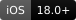
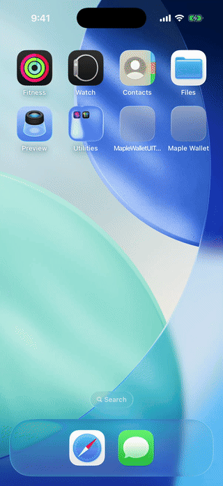
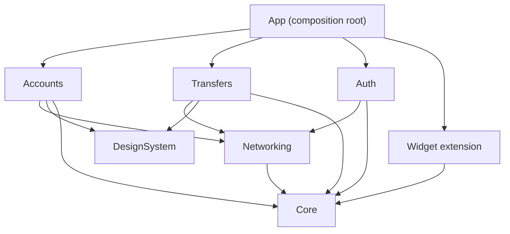

<div align="center">

# 🍁 Maple Wallet

**A modular SwiftUI banking demo: Swift 6 strict concurrency, OAuth PKCE sign-in, offline cache and full VoiceOver support**

[](https://github.com/jamierowe15/maple-wallet/actions/workflows/ci.yml)
[](project.yml)
[](docs/adr/0002-concurrency-model.md)
[](#-architecture)
[](#-tests-and-coverage)
[](LICENSE)

*Fictional brand, fake data, no real money.*

<!-- auto:demo -->

<!-- /auto:demo -->

### [📅 Daily reports](docs/day-1.md) · [🏛 ADRs](docs/adr/0001-modular-spm.md) · [🔐 Security](docs/security.md) · [♿ Accessibility](docs/accessibility.md)

</div>

---

## 📑 Contents
- [Highlights](#-highlights)
- [Architecture](#-architecture)
- [Run it](#-run-it)
- [Tests and coverage](#-tests-and-coverage)
- [Docs](#-docs)
- [Related iOS labs](#-related-ios-labs)

## ✨ Highlights

| Area | What's in it |
|---|---|
| **MVVM** | `@Observable @MainActor` view models with explicit state enums |
| **Boundaries** | Protocols at every boundary (`AccountsService`, `HTTPTransport`, `TokenStore`...), wired in `App/CompositionRoot.swift` |
| **Concurrency** | `async let`, task groups, cancellation via `.task {}`, a `TokenProvider` actor that turns five 401s into one refresh |
| **Security** | Authorization Code + PKCE via `ASWebAuthenticationSession`, tokens only in the Keychain, certificate pinning, file protection, Face ID lock |
| **Accessibility** | VoiceOver labels and custom actions, Dynamic Type to AX5, Reduce Motion, high-contrast colours, iPad split view, automated audit |
| **Apple platform** | Home Screen widget, push notification deep links, Apple Pay top-up |

## 🏛 Architecture


- **MVVM**: `@Observable @MainActor` view models with explicit state enums.
- **Protocols at every boundary** (`AccountsService`, `HTTPTransport`, `TokenStore`...), wired in `App/CompositionRoot.swift`.
- **Concurrency**: `async let`, task groups, cancellation via `.task {}`, a `TokenProvider` actor that turns five 401s into one refresh.
- **Security**: Authorization Code + PKCE via `ASWebAuthenticationSession`, tokens only in the Keychain, certificate pinning, file protection, Face ID lock.
- **Accessibility**: VoiceOver labels and custom actions, Dynamic Type to AX5, Reduce Motion, high-contrast colours, iPad split view, automated audit.
- **Apple platform**: Home Screen widget, push notification deep links, Apple Pay top-up.

## 🚀 Run it

```bash
git clone https://github.com/jamierowe15/maple-wallet.git && cd maple-wallet
scripts/bootstrap.sh            # macOS: installs XcodeGen, generates and opens the project
scripts/run_package_tests.sh    # any OS with Swift: logic tests + coverage gate
```

## ✅ Tests and coverage

<!-- auto:coverage -->
| Package | Line coverage | Lines | Gate |
|---|---|---|---|
| Core | 78.9% | 128 | report only |
| Networking | 87.4% | 191 | PASS (min 70%) |
| Auth | 84.8% | 276 | PASS (min 70%) |
| Accounts | 82.6% | 219 | PASS (min 70%) |
| Transfers | 82.5% | 63 | report only |
<!-- /auto:coverage -->

## 📚 Docs

- Daily reports: [Day 1](docs/day-1.md) · [Day 2](docs/day-2.md) · [Day 3](docs/day-3.md) · [Day 4](docs/day-4.md) · [Day 5](docs/day-5.md)
- ADRs: [0001 Modular SPM](docs/adr/0001-modular-spm.md) · [0002 Concurrency](docs/adr/0002-concurrency-model.md) · [0003 Auth](docs/adr/0003-auth-and-web-views.md)
- Specs: [Accounts](docs/specs/accounts.md) · [Sign-in](docs/specs/auth.md) · [Transfers](docs/specs/transfers.md)
- [Security notes](docs/security.md) · [Accessibility](docs/accessibility.md) · [Code review guide](docs/code-review-guide.md) · [Contributing](CONTRIBUTING.md) · [Onboarding](docs/onboarding.md)
- [How each job requirement is met](docs/REQUIREMENTS.md) · [Lab checklist](docs/LAB-CHECKLIST.md)

## 📱 Related iOS labs

| App | Focus |
|---|---|
| [Maple Wallet](https://github.com/jamierowe15/maple-wallet) | Modular SwiftUI banking demo: Swift 6 concurrency, OAuth PKCE, offline cache, VoiceOver |
| [Loonie Rates](https://github.com/jamierowe15/loonie-rates) | UIKit app with Bank of Canada exchange rates, Swift Charts, English and French |
| [Pocket Budget](https://github.com/jamierowe15/pocket-budget) | SwiftUI + SwiftData budget tracker with a widget and Siri Shortcuts |

---

<div align="center">

**Jamie Rowe** · [github.com/jamierowe15](https://github.com/jamierowe15) · Toronto, ON

*Fictional brand and data. Not affiliated with any bank.*

</div>
