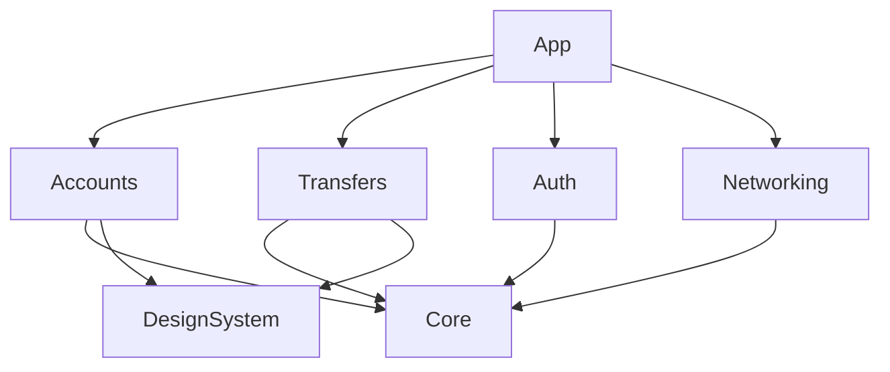

# Day 1: Architecture, SPM modules and SwiftUI components

The app launches to an Accounts screen built from reusable components, with every dependency injected through a protocol.

## Module diagram

Features depend on `Core` (models + protocols) and `DesignSystem`, never on each other.
Only `App/CompositionRoot.swift` knows the concrete types.

## Screenshots
<!-- auto:screens-day1 -->
_Generated automatically by `bash maple-wallet-lab.sh evidence` (runs on GitHub's Macs)._
<!-- /auto:screens-day1 -->

## Modern Swift features used
| Feature | Where | Why it helps |
|---------|-------|--------------|
| `@Observable` | `AccountsViewModel` | Views redraw only when a property they read changes, with no `@Published` boilerplate. |
| Swift 6 strict concurrency | whole project | Data races become compile errors instead of rare production crashes. |
| `#Preview` macro | `DesignSystem/Previews.swift` | Every component is checked in light, dark and AX5 text without running the app. |
| Swift Testing (`@Test`, `#expect`, parameterized tests) | `CoreTests`, `AccountsTests` | One test runs over many inputs, and failures show the exact values. |
| Typed throws `throws(APIError)` | `APIClient` (Day 2) | Callers know the exact error type they must handle. |

## What was learned
Splitting into packages made the rules enforceable: a feature cannot import another feature because it isn't a dependency.
Putting the view model outside `#if canImport(UIKit)` meant its tests run on Windows, Linux and macOS.
An explicit state enum removed impossible combinations such as "loading and failed at the same time".
