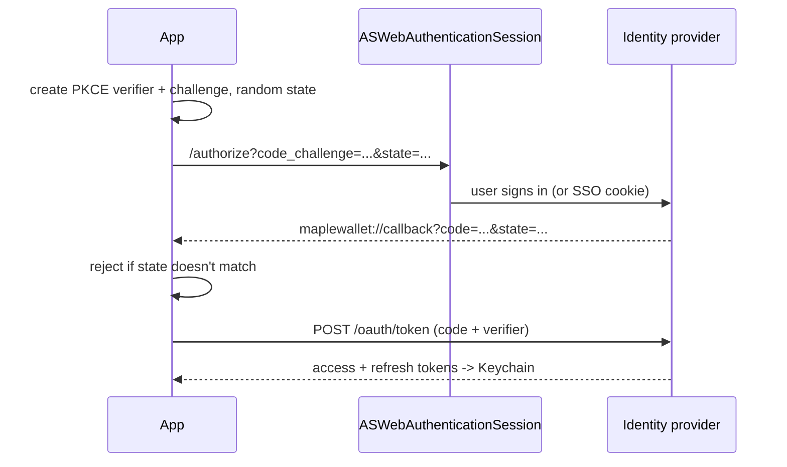

# Day 3: Auth flows, secure SSO and Keychain

Users sign in through a system web session with PKCE, tokens live only in the Keychain, and an expired token refreshes once without the user noticing.

## Recording: sign in, silent refresh, sign out
<!-- auto:recording-sso -->
_Generated automatically by `bash maple-wallet-lab.sh evidence` (runs on GitHub's Macs)._
<!-- /auto:recording-sso -->

The demo uses a short token lifetime (`-tokenLifetime 8`). The debug row on the More tab shows the token number change from `stub-access-0` to `stub-access-1` after the silent refresh.

## Flow

## Using a real tenant (optional)
Create `Config/Auth.local.xcconfig` (git-ignored) with `AUTH0_DOMAIN` and `AUTH0_CLIENT_ID`, set the Auth0 app type to Native and the callback to `maplewallet://callback`.

## Proof
- `TokenProviderTests.fiveConcurrentRefreshesMakeOneNetworkCall`
- `ParallelUnauthorizedRequestsTests.fiveParallel401sTriggerExactlyOneRefresh`
- `CallbackValidatorTests.rejectsStateMismatch`, `SignInServiceTests.tamperedStateIsRejectedAndNothingIsStored`
- `AllowlistTests` (web view stays on the allowlisted host), `PinSetTests` (pinning reject path)
- `git grep -i secret` finds only documentation and the test asserting there is no `client_secret`.
