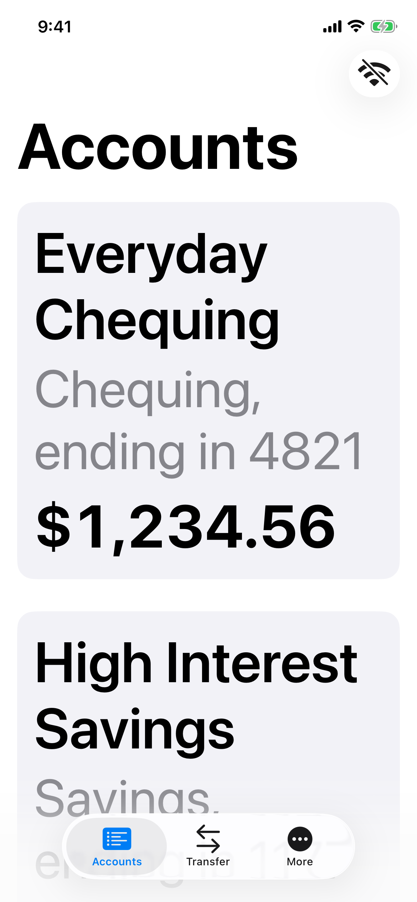
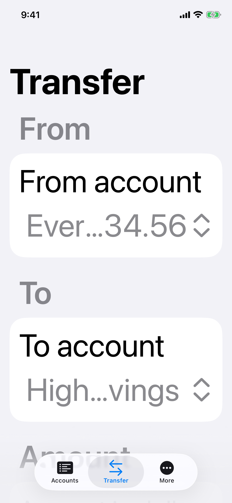
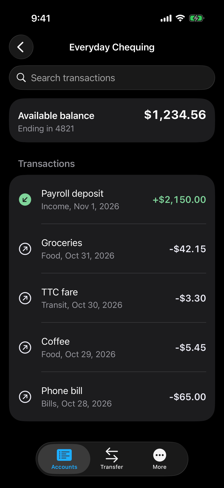
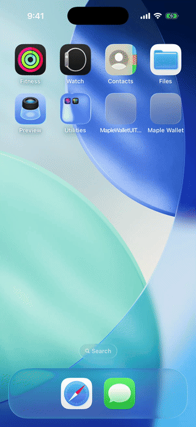

# Day 4: Accessibility and adaptive iPhone/iPad layouts

A VoiceOver user can sign in, check a balance and send a transfer, and the app adapts from a small iPhone at the largest text size to iPad split view.

## Screenshots: Dark Mode, AX5 text and iPad
<!-- auto:screens-day4 -->
| Accounts at AX5 text | Transfer at AX5 text | Detail, Dark Mode |
|---|---|---|
|  |  |  |
<!-- /auto:screens-day4 -->

## Recording: the main flow
<!-- auto:recording-main -->

<!-- /auto:recording-main -->

## Push notifications in the Simulator
```bash
xcrun simctl push booted push/transfer-received.apns
```
Tap the banner: the app opens Everyday Chequing (`DeepLinkRouter` handles the `deepLink` field).

## Deep links
```bash
xcrun simctl openurl booted "maplewallet://accounts/sav-002"
xcrun simctl openurl booted "maplewallet://transfer"
```

## Why universal links beat custom schemes for a bank
Any app can register `maplewallet://`, so a malicious app could intercept links meant for the bank.
A universal link is an `https` URL that iOS opens in the app only after checking the bank's own website lists the app in `apple-app-site-association`.
If the app isn't installed, the same link opens the bank's website instead of failing.

## Widget
Add the "Balance" widget from the Home Screen. It reads a snapshot from the App Group and is redacted when the phone is locked.

## Face ID lock
More > Security > "Require Face ID to open" locks the app when it goes to the background (`AppLock`). In the Simulator: Features > Face ID > Enrolled.

## Proof
`TransferViewModelTests` (validation and phases), `SpokenMoneyTests`, `DeepLinkRouterTests`, `MoneyParsingTests`, and the automated audit in [accessibility.md](accessibility.md).
